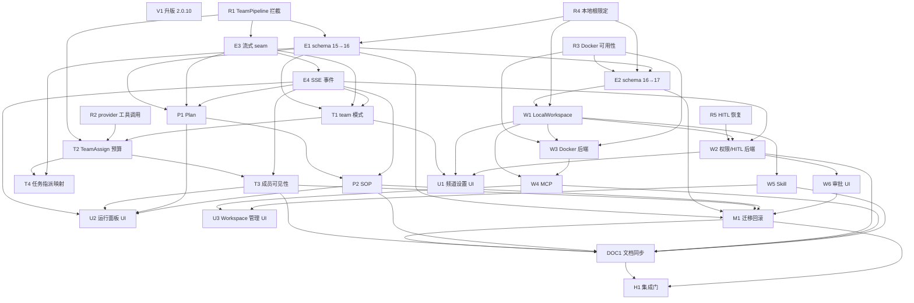

# AgentScope 2 对齐规格：team 模式、事件流、Plan/SOP、Workspace 与权限

> 状态：规格票 + 票据拆分正本 ｜ 日期：2026-10-18 ｜ 基线：`main` @ `826c96e`（`SCHEMA_VERSION = 15`，`agentscope==2.0.9`）
>
> Part of #1（首版规格锚点）｜ 规格 issue：**#131** ｜ 规格 PR：**#160**（子票为 #132–#159）。
>
> **待确认**：D1–D17 已由用户裁定；**D18–D23 是第二轮 ask 的推荐默认（A），两次 ask 超时未收到回执**（messageId `msg_2e2c47de1dcf`）。实施前必须由 owner 确认；若回执不同，按回执改写本文件与相关票。
>
> **票型**：规格票 + 票据拆分 ｜ **门禁**：G-spec + G-tickets ｜ **本票不跑**：源码实施测试、双轴源码 review、浏览器 UI 验证。
>
> 本文件只产出规格、ADR 与 GitHub Issues 票图；**不改** `app/alibot/**`、`app/tests/**`、`app/pyproject.toml`、`.github/**`，不实施任何生产代码或迁移脚本，不创建实施 PR。唯一 PR 是规格 PR（文档 diff），并且它是**单向门**：保持开放，由人类手动合并（D8）。

## 1. 决策基线（D1–D12，逐条可检索）

本轮决策由用户口述并逐条固定。**本节是唯一决策基线，后续章节只解释落点，不重新讨论。** `D13`–`D23` 是本轮两轮 `orchestration ask` 的追加裁定；它们与 `D1`–`D12` 同级，不得被实施票改写。

| 编号 | 决策 | 代价 / 边界（必须一起接受） |
| --- | --- | --- |
| **D1** | **协作拓扑双模式。** 默认 `autonomous`：保留现有全成员唤醒、Agent 自判、`auto_claim`。频道可显式设 `team` 模式，并由 owner 指定一个 Agent 作为**队长**。**DM 恒为 autonomous。** team 模式下频道消息只唤醒队长；**穿透**（@ 未加入成员）仍可一次性送达，但穿透成员**不进入 pipeline**。 | team 模式是**显式 opt-in**，不是默认；队长是频道配置里的一行引用，不是新的成员类型。穿透仍不豁免预算。 |
| **D2** | **成员产出可见性。** team 模式下只有**队长的最终回复**落为频道消息；成员输出走 **SSE 事件流**与 `team_assignment`（规格定义的等价运行记录），**不占频道消息、未读、搜索**。队长最终回复**不再唤醒成员**（pipeline 已收回结果），避免 pipeline 外的自主循环。 | 成员的过程不再有 `message` 行；事后取证靠 `team_assignment` 与 SSE 实时帧。SSE 是**直播面**，断开期间不补发（补拉只覆盖消息与轮次结果）。 |
| **D3** | **预算。** 每次 `TeamAssign` 计 **1 跳**，推进 `target_budget.used`；耗尽时给队长一个**错误 `ToolResult`**，**不运行该成员**。实现必须绕开 `on_acting` 看不到 external execution 的限制（例如继承 `TeamPipeline` 覆写 `_run_assignments`，或规格论证的等价拦截点）。**每次分派前的检查与扣减必须原子。** 队长最终回复不再唤醒成员，因此不与现有“跳”重复计数。 | 预算从“Agent 消息投递”扩成“team 轮次内的分派”；同一个 `target_budget` 仍是唯一正本。一次分派即使成员失败也已计跳，**不退款**。 |
| **D4** | **事件。** SSE 透传 `AgentEvent`（`ReplyStart` / `TextBlockDelta` / `ToolCall` / `ToolResult` / `Thinking` 等）；数据库仍只存**最终正文消息**，append-only、未读、搜索、轮次语义不变。成员面接缝新增**流式出口**（`run_round_stream` 或规格论证的等价物），既有 `run_round` 保留给脚本化替身与既有测试。SSE 新事件类型**必须带** `member_id` / `reply_id` / `target_id`，便于前端归属。 | 事件不是消息：不能从事件流重建完整历史，也不能把 token 级增量当业务正本。事件量可能触发 `EventBus` 的 256 队列上限（丢事件、不阻塞写路径）。 |
| **D5** | **范围：全部三阶段。** (a) 事件流 + team pipeline + `TeamAssign` 预算 + 任务指派映射；(b) Plan（`TaskCreate` / `TaskGet` / `TaskList` / `TaskUpdate`）与 SOP（`SOPEngine` / `SOPStep`）；(c) Workspace / MCP / Skill / 权限 / HITL。 | 三阶段都进票图；不允许把 (b)/(c) 降级成“后续”。阶段内可以拆票，但每票必须可独立验收。 |
| **D6** | **Workspace：用户选择“全部”。** 规格同时覆盖：LocalWorkspace + 每频道项目根 + 路径限定（不得越出根）；Docker 沙箱作为可选后端（每 Agent/会话隔离）；MCP 服务与 Skill 的装配/管理；权限模式与工具审批（默认读允许、写/执行需人审批，可配置）；与“数据目录可整体备份”“库里不存密钥”“Agent 不经 HTTP”的关系。 | “全部”不等于“无边界”：本地 shell 的根限定、Docker 依赖、MCP 远端数据面、Skill 来源都在 D15/D21/D18 等条目里收窄。 |
| **D7** | **版本。** `agentscope` 从 **2.0.9** 升到 **2.0.10**，并把升版作为**独立票**（含 API 差异核对与回归）。 | 升版是独立可回滚的依赖变更；不与任何行为票混在一起。 |
| **D8** | **门。** 本程序会触发 schema 迁移、权限/信任边界、依赖升级，属**单向门**；集成 PR 必须**保持开放**，由人类**手动合并**。票图与规格必须写明这一点，不得设计自动合并。 | 没有任何“合并机器人”“自动 mark ready 并合并”的路径；只有人类在读完 Evidence 后手动 merge。 |
| **D9** | **术语。** 保留本仓 `channel` = 消息容器、`session` = 模型上下文之外的既有含义；**不使用** `agentscope deploy/channel`（IM 渠道）与 `deploy/agent-team`（消息总线/多会话服务）。只用进程内 `TeamPipeline`、`Agent` / `AgentState`、`AgentEvent`、`Plan`、`SOP`、`Middleware`、`Workspace`、`Permission` 这些 building blocks。 | 不引入第二套“频道/会话/团队”叫法；框架的 Agent Service / deploy 面不进本仓。 |
| **D10** | **成员命名。** `TeamPipeline` 要求成员名唯一且不等于队长名；本仓 `display_name` 不唯一。规格必须用 **member id 派生 pipeline 内部名**，显示名不变。 | 派生名只活在 pipeline 内部与事件归属映射里；不落库、不显示、不改成员身份。 |
| **D11** | **动态成员。** pipeline **每轮按当前频道成员重建**；成员加入/移除不要求重启进程。 | 轮次开始后成员变化从**下一轮**生效；不保证同一轮中途新成员参与。 |
| **D12** | **既有约定处置。** `CONTEXT.md` 的“成员平等自主”“认领”“一轮一消息”“Agent 不做文件与 shell”在 team/workspace 模式下被扩展或部分取代时，必须新增 ADR 说明“扩展了什么、保留了什么、被取代的是什么”，不得静默改写既有词条的原意。 | 既有 ADR 原文一字不改；新 ADR 只追加。`CONTEXT.md` 只在规格确认需要时改，并标明改的是哪条词条。 |

### 1.1 本轮 ask 追加裁定（D13–D17）

| 编号 | 决策 | 代价 / 边界 |
| --- | --- | --- |
| **D13** | **Plan 的落点。** 新增运行期 `plan_run` / `plan_task` 表（按 `member + target + run`），与既有「任务」五态**严格分离**；只在**运行面板 / SSE** 展示，**不进看板、未读、搜索**。必须补清理/保留策略与迁移。 | Plan 是成员的**工作清单**，不是用户的任务对象；它**不新增 target**（只挂在既有 target 上），不计未读、不唤醒、不耗预算。保留策略见 §3.5。 |
| **D14** | **Workspace / 权限配置粒度。** **频道**配置项目根；**每个 Agent** 可配 `local` / `docker` 后端与权限模式。 | 频道根是共享项目边界；Agent 级后端/权限是隔离与信任的粒度。频道默认值可被 Agent 覆盖，但 Agent 不能越出频道根（local）或容器挂载（docker）。 |
| **D15** | **本地 shell 边界。** 本地模式默认**只开文件工具**并强制根目录限定；**Bash 默认仅在 Docker 后端开放**。本地 Bash 必须**显式开启**、**逐次审批**并**明确告知无沙箱**。 | “本地 Bash = 主机进程”这条事实不能被文案掩盖；默认关闭是安全边界，不是能力缺失。显式开启的用户接受无沙箱风险。 |
| **D16** | **team 模式下 `auto_claim`。** 关闭该频道**全部成员**的 `auto_claim`；任务只能由 **owner 指派**或**队长经 `TeamAssign` 分派**。 | `auto_claim` 是配置，不在 team 模式下被读取；不删除既有列、不改 autonomous 行为。队长分派仍走 `TeamAssign` 预算，不产生“认领”。 |
| **D17** | **穿透的可见性。** 穿透是 **pipeline 外的一次性直答**：其回复照常落为**频道消息**；**D2 只约束 pipeline 成员输出**。 | 穿透回复会占用一条频道消息与未读（既有语义），但不进入 team pipeline、不产生 `team_assignment`、不再唤醒任何人。 |

### 1.2 第二轮 ask 推荐默认（D18–D23，待 owner 确认）

> Q6–Q11 的 ask 两次超时（最近 messageId `msg_2e2c47de1dcf`，900s 与 600s 均无回执）。下表是**规格的推荐默认 A**，不是已收到的用户裁定；实施前必须确认。

| 编号 | 决策 | 代价 / 边界 |
| --- | --- | --- |
| **D18**（推荐 A，待确认） | **队长不可用。** 队长被禁用/软删除时**不回落 autonomous**：该频道进入「配置无效」状态，消息照常落库但**不唤醒任何人**；频道设置与状态点给出可读原因，owner 必须启用或改选队长。 | 这是**显式失败面**，不是静默降级；不会把 team 频道偷偷变成全员唤醒。 |
| **D19**（推荐 A，待确认） | **HITL 持久性。** 首版进程内**有界等待**（默认 10 分钟，超时收口 `failed`）；审批请求**落库**供 UI 展示；进程重启后未决审批标为 `expired`、该轮 `failed`，**不支持跨重启恢复**。 | 跨重启恢复（持久化参与者 `AgentState` 并重建 `TeamPipeline`）另开后续票；首版不承诺。 |
| **D20**（推荐 A，待确认） | **Plan / SOP 启动面。** Plan 在每个**任务/team 轮次**自动可用并持久化；SOP 只能由 **owner 显式启动**（或队长在 `TeamAssign` 中建议、由 owner 确认），Agent **不能自行创建并运行 SOP**。 | Plan 是轮次内建能力；SOP 是 owner 的运行编排，不是模型的自由动作。 |
| **D21**（推荐 A，待确认） | **MCP / Skill 来源。** 本轮只支持**本机目录 / 上传 zip / 本机 stdio 与 HTTP MCP**，不做远程市场或自动下载。 | 不引入第三方内容市场、远程注册表、自动更新；远端 MCP 只按用户显式配置的连接串访问，并单独做数据面告知。 |
| **D22**（推荐 A，待确认） | **权限档位。** 对外只暴露 `read-only` / `ask-writes`（默认）/ `trusted-writes`（工作目录内自动写）；框架的 `DEFAULT`/`EXPLORE` 映射到前两档，**不暴露 `BYPASS`**；`DONT_ASK` 不暴露。 | 没有“完全跳过安全审批”的 UI 档位；`trusted-writes` 仍只限工作目录内，越界写仍要审批。 |
| **D23**（推荐 A，待确认） | **team 模式作用范围。** 只作用于 **channel 型 target**；该频道下的**任务线程仍按既有任务语义**（受派者/认领）唤醒。`TeamAssign` 在任务线程里只作**运行期分派记录**，不改任务五态。 | 任务线程不会被 team 模式“队长化”；任务看板、五态、认领、预算世代全部不变。 |

## 2. 现状与 gap

本节只写**可核对的事实**。行号以基线 `826c96e` 为准；符号名是正本。

### 2.1 唤醒面是“全成员”，没有模式与队长

- `app/alibot/orchestration.py:193` 的 `WakeOrchestrator.notify()` 在消息落库后读取 target 与消息，`app/alibot/orchestration.py:355` 的 `_wake_targets()` 返回**该 target 全部 Agent 成员（排除作者）+ 被点名的穿透候选**。没有“只唤醒队长”的分支。
- `app/alibot/orchestration.py:219` 对 DM 的 Agent 作者消息直接 `return 0`；频道/任务没有对应分支。
- `app/alibot/orchestration.py:230` 的 `jump_delivered = author_kind == "agent" and target["kind"] != "dm"` 把“Agent 消息投递唤醒”作为一次跳的唯一来源；team pipeline 的 `TeamAssign` 不经过这条路径。
- `CONTEXT.md` 第 19 行明写 Agent “不做文件与 shell 操作（首版没有家目录、项目目录与沙箱）”；`CONTEXT.md` 的**成员 (Member)** / **唤醒 (Wake)** / **轮次 (Round)** 词条把“成员平等自主”“一轮至多一条 target 消息”作为现行协议。

### 2.2 预算只认“Agent 消息投递”，看不到 external execution

- `app/alibot/orchestration.py:388` 的 `_spend_jump()` 在编排锁内读 `db.budget_state()`、判断 `used >= limit`、再 `db.consume_budget()`；它只被 `notify()` 的一次 Agent 消息投递调用。
- `app/alibot/db.py:378` 的 `target_budget(target_id, epoch_seq, used, applied_limit)` 是跳数正本；`app/alibot/db.py:2714` `budget_state()`、`app/alibot/db.py:2800` `consume_budget()` 是现有读写口。
- AgentScope 2.0.10 的 `MiddlewareBase.on_acting()` 只包住 `toolkit.call_tool`，**权限检查、输入校验与上下文写入都在它外面**（源码 `middleware/_base.py:124-139` 的 docstring 明写 “Permission checking, input validation, and context writes are handled by the agent outside this hook”）。因此不能用 `on_acting` 在 `TeamAssign` 真正执行成员前拦截；`TeamPipeline._run_assignments()`（源码 `pipeline/_team_pipeline.py:284`）才是分派执行点。

### 2.3 成员面接缝是“一轮一个 `RoundOutcome`”，事件被丢给框架

- `app/alibot/agent_seam.py:238` 的 `AgentSeam` 只声明 `run_round()`；`app/alibot/agent_seam.py:358` 的真实实现每轮新建 `Agent`，调用 `instance.reply(...)`，只把最终 `Msg` 收口成 `RoundOutcome`。`AgentEvent`（`ReplyStart` / `TextBlockDelta` / `ToolCall` / `ToolResult` / `Thinking` 等）在 `asyncio.run()` 内部被消费，**没有出口**。
- `app/alibot/events.py:30` 的 `EventBus` 只有按 target 分组的进程内队列；`app/alibot/events.py:65` 的 `sse_frame()` 用 `seq` 作为 SSE `id`。现有事件类型只有 `message` / `member_status` / `typing` / `round_outcome`（`app/alibot/events.py:1-20` 的 docstring）。
- `app/alibot/api.py:821` / `:898` / `:947` 分别是频道/任务/DM 的 SSE 端点；补拉只覆盖消息与轮次结果，事件总线不保留历史。

### 2.4 数据库没有 team 运行、Plan、SOP、Workspace、权限的运行记录

- `app/alibot/db.py:73` `SCHEMA_VERSION = 15`；`SCHEMA`（`app/alibot/db.py:223` 起）只有 member / channel / target / target_member / task / message / attachment / target_read / target_budget / channel_budget_limit / agent_config / workspace_settings / reminder / remote_consent / round_outcome。
- `app/alibot/db.py:465` 的 `round_outcome.status` 是**封闭六态**（`replied` / `ignored` / `failed` / `merged` / `budget-exhausted` / `silent`），并由 `ROUND_STATUSES` 与 README 词表守卫（`app/tests/test_docs_vocabulary_guard.py`）。成员在 team pipeline 里的“回复”不是频道消息，也没有通用唤醒；把它塞进 `round_outcome` 会污染这个六态契约。
- `app/alibot/db.py:378` 的 `target_budget` 是每 target 一行；没有记录“哪一次 TeamAssign 消耗了哪一跳”的表。

### 2.5 Agent 没有 Workspace / MCP / Skill / Permission 的装配面

- `app/alibot/agent_seam.py:384` 的 `_round()` 只构造 `Agent(name, system_prompt, model, toolkit)`；`_round_toolkit()`（`app/alibot/agent_seam.py:595`）只挂任务动作与 `declare_silence`，没有 `WorkspaceBase.list_tools()`、`list_mcps()`、`list_skills()`、`offloader`、`PermissionEngine`。
- AgentScope 2.0.10 已提供 `LocalWorkspace` / `DockerWorkspace` / `PermissionEngine` / `MCPClient` / `Skill` / `TeamPipeline` / `SOPEngine`，但本仓没有采用；pin 仍是 `agentscope==2.0.9`（`app/pyproject.toml:13`）。
- `CONTEXT.md` 的 **结构身份 (Structural Identity)** 与 ADR-0003 把“Agent 不经 HTTP”定死；Workspace/MCP 的引入必须沿用这条边界，不能给 Agent 发令牌。

### 2.6 版本与实验状态

- `app/pyproject.toml:11-13` 的注释记录 2026-10-13 核对 `stable → 2.0.9`，PyPI 当时最新为 2.0.10；当前 pin 是 2.0.9。
- AgentScope 2.0.10 的 `pipeline/_team_pipeline.py` 与 `sop/` 已存在；官方团队流水线文档明写“流水线模块处于实验阶段，接口可能在后续版本调整”，SOP 文档同样明写“SOP 模块处于实验阶段”，`METADATA` 的 News 把 SOP 标成 `Experimental`。**本规格不把这两个模块写成稳定承诺。**
- 2.0.10 相对 2.0.9 的已核对差异（用于 D7 票）：`TeamPipeline._run_assignments()` 的 `run_all()` 增加了并发任务的取消/收尾；`SOPEngine` 在 `FAILED` 时不再重试；`WorkspaceBase` 的 `file://` 改成 `workspace://`；`LocalWorkspace` 的技能目录名冲突检查扩到文件系统存在性；`ToolBase` 路径校验从 `abspath` 改为 `realpath`；`FunctionTool` 适配器改为 `inspect.isawaitable`；`MCPClient` 的 HTTP 客户端改用 SDK 工厂；`Msg.append_usage` 复制 usage。它们不是本规格的承诺，只是 D7 票的核对清单。

### 2.7 任务五态与 team 分派没有映射

- `app/alibot/db.py:269` 的 `task.status` 是五态 `todo` / `in_progress` / `in_review` / `done` / `closed`；`CONTEXT.md` 的**任务状态**与 ADR-0006 规定“当前态在行上、变更史在消息流里”。
- `app/alibot/orchestration.py:681` 的 `_apply_task_action()` 只接受 `TransferTaskAction` / `SetTaskStatusAction`；没有“TeamAssign 分派给某成员”的记录。
- 直接后果：team 模式下队长分派了谁、分派了什么、成员回了什么，今天**没有可查的运行记录**；看板只反映任务行，不能替代运行记录。

### 2.8 与既有 ADR 的关系（原文不改，只登记扩展/收窄）

| 既有 ADR | 现行结论 | 本规格的处置 |
| --- | --- | --- |
| **ADR-0002**（回应预算 ≤ 3） | 每个 target 每个**人类世代**最多 3 次 agent→agent 跳；耗尽零投递；跳数正本是 `target_budget.used` | **扩展**：team 模式的 `TeamAssign` 也计 1 跳（ADR-0019）；上界语义、零投递/不运行的构造性保证不变；原文不改 |
| **ADR-0005**（派任务是人的发言） | 唤醒的载体是“指派”这个动作；owner 改派 = 人类世代，Agent 转派 = 1 跳；改状态/标题不唤醒 | **保留**：owner 指派与 Agent 转派语义不变；`TeamAssign` 是**运行期分派**，不改任务行、不写任务变更记录（ADR-0022） |
| **ADR-0010 / ADR-0016**（认领） | 认领由编排发起、不是跳、每任务至多一次、首次认领开世代、认领即开工 | **收窄**：team 模式关闭该频道全部成员的 `auto_claim`（D16）；task 型 target 仍按既有认领语义（D23 推荐默认）；认领的预算与世代规则不变 |
| **ADR-0006**（任务态在行上、变更史在流里） | 任务行可变；每次变更追加 `system` 消息 | **保留**：Plan/SOP/TeamAssign 都不改任务行、不写任务变更消息；任务历史仍只有任务 target 的消息流（ADR-0022 / ADR-0023） |
| **ADR-0003**（结构身份） | Agent 不经 HTTP，身份由调用点决定 | **保留**：Workspace/MCP/Skill/审批回传都在进程内或容器内；不新增 Agent 令牌（ADR-0021） |

### 2.8 Gap → 票（索引）

| Gap | 证据 | 对应票 |
| --- | --- | --- |
| 无 team 模式 / 队长 / 只唤醒队长 | §2.1 | T1 |
| TeamAssign 不计跳、无法在分派前原子扣减 | §2.2 | T2 |
| 事件流没有 AgentEvent 出口与归属 | §2.3 | E3 / E4 |
| 成员输出缺少等价运行记录 | §2.4 | T3 |
| Plan / SOP 无持久化与 UI | §2.4 / §2.6 | P1 / P2 |
| Workspace / MCP / Skill / 权限 / HITL 未装配 | §2.5 | W1–W6 |
| 任务与运行期分派无映射 | §2.7 | T4 |
| 2.0.10 未升级 | §2.6 | V1 |
| schema 与迁移未扩展 | §2.4 | E1 / E2 / M1 |

## 3. 目标架构

### 3.1 模块边界

```text
app/alibot/
├── orchestration.py     # 唤醒裁决（autonomous / team）、轮次、leader 最终消息、预算入口
├── agent_seam.py        # run_round + run_round_stream；单 Agent 与 TeamPipeline 的适配
├── team.py              # BudgetedTeamPipeline、id 派生名、TeamAssign 拦截、运行记录
├── events.py            # 事件词表、live-only 帧、EventBus
├── db.py                # schema、原子预算、team_assignment/plan/sop/approval/workspace 读写
├── plan.py              # Plan 的持久化与保留策略
├── sop.py               # SOP 定义/运行、SOPEngine 适配、状态持久化
├── workspace.py         # Local/Docker 装配、项目根、路径策略、MCP/Skill 物化
├── permissions.py       # 三档权限配置、PermissionRule、ApprovalBroker
├── api.py               # 人类面端点（HTTP 只属于人类面）
└── studio/              # 频道设置、运行面板、Workspace/MCP/Skill 管理、审批
```

边界纪律：

- **HTTP 面仍只属于人类面**（ADR-0003）。Agent 的 Workspace 工具、MCP、Skill、TeamAssign 都在**进程内或容器内**执行，不新增 Agent 令牌。
- **消息正本仍是 `message` 表**；`round_outcome` 仍是六态；`team_assignment` / `plan_*` / `sop_*` / `approval_request` 是**运行记录**，不是消息。
- **所有新运行记录都挂在 `target_id` 上**，但只有 `message` / `round_outcome` 进入未读、搜索与 SSE 补拉。

### 3.2 成员面接缝的形状

新增**流式出口**，既有 `run_round` 保留：

```text
@dataclass
class AgentEventRecord:
    type: str          # REPLY_START / TEXT_BLOCK_DELTA / TOOL_CALL_START / ...
    target_id: str
    member_id: str
    reply_id: str
    payload: dict[str, Any]   # 框架事件字段的白名单副本，不含 secrets

class AgentSeam(Protocol):
    def run_round(self, agent, messages, *, mentioned, target_id,
                  task_context=None, mandatory_reply=False) -> RoundOutcome: ...
    def run_round_stream(
        self, agent, messages, *, mentioned, target_id,
        task_context=None, mandatory_reply=False,
        emit: Callable[[AgentEventRecord], None] | None = None,
    ) -> RoundOutcome: ...
```

- `run_round` = `run_round_stream(..., emit=None)` 的兼容壳；既有脚本化替身与测试不用改语义。
- 真实适配器在 `run_round_stream` 内消费 `AgentEvent`：对单 Agent 直接 `async for evt in instance.reply_stream(...)`；对 team 模式消费 `BudgetedTeamPipeline.reply_stream(...)`。
- **归属映射**：`ReplyStartEvent` 有 `name` 与 `reply_id`；先用 D10 的“member id 派生名 → member id”表把 `name` 映射成 `member_id`，再用 `reply_id → member_id` 表给后续无 `name` 的事件归属。没有 `ReplyStart` 的孤儿事件（理论上不存在）丢弃并记一条 debug，不猜。
- **白名单**：只透传 `ReplyStart` / `ReplyEnd` / `TextBlock*` / `ThinkingBlock*` / `ToolCall*` / `ToolResult*` / `HintBlock` / `RequireUserConfirm` / `CustomEvent`；`DataBlock*` 只透传元数据（media_type / 长度），不透传 base64 正文。
- `RoundOutcome` 仍是**队长的**轮次结论；成员结论写 `team_assignment`，不写 `round_outcome`。

### 3.3 team 模式的生命周期

```text
人类消息落库（channel 型 target，mode=team）
  → notify(target_id, seq)
      → 读取 channel.mode / team_leader_member_id
      → 唤醒集合 = {队长}（若队长可用）+ 被点名的穿透候选（一次性，不进 pipeline）
      → 队长不可用 ⇒ 零投递，记录可读原因（D18）
  → 队长轮次：run_round_stream
      → 按当前频道成员重建 BudgetedTeamPipeline（D11）
      → 队长可调用 TeamAssign
          → 原子扣 1 跳；耗尽 ⇒ 错误 ToolResult，不运行成员（D3）
          → 运行成员；成员事件带 member_id / reply_id / target_id 进 SSE
          → 成员最终回复作为 ToolResult 回队长；不落 message
      → 队长最终回复落 message（唯一一条）
  → notify 对队长最终回复返回 0（D2）
```

运行矩阵（只列 team 相关；未列组合沿用现行）：

| target kind | mode | 消息作者 | 结果 |
| --- | --- | --- | --- |
| channel | team | human | 只唤醒队长；穿透候选一次性送达 |
| channel | team | agent（队长） | **零唤醒**（D2） |
| channel | team | agent（穿透成员） | **零唤醒**；回复已按 D17 落为频道消息 |
| channel | team | system | 零唤醒 |
| channel | autonomous | 任意 | 既有 `notify` 不变 |
| dm | autonomous | 任意 | 既有 `notify` 不变 |
| task | 任意 | 任意 | 既有任务唤醒；team 模式不覆盖（D23） |

### 3.4 预算裁决点

**不**用 `on_acting`。在 `team.py` 里继承 `TeamPipeline`：

```text
class BudgetedTeamPipeline(TeamPipeline):
    async def _run_assignments(self, tool_calls, results, resumed=None):
        # 1) 先按调用顺序逐条原子裁决，保留调用顺序
        decisions = {}
        for call in tool_calls:
            member_id = self._name_to_member[self._parse(call)["member"]]
            decision = self._budget.try_consume_jump(self.target_id)  # 单事务 UPDATE ... WHERE used < limit
            decisions[call.id] = (member_id, decision)
            self._record_assignment(call, member_id, decision)
        # 2) 未获授权的 call 直接生成 ERROR ToolResult；不进入 run_group
        # 3) 获授权的 call 按成员分组并发运行（沿用基类语义）
        # 4) 结果按 tool_calls 顺序合并，保证队长看到的顺序稳定
```

- `try_consume_jump(target_id)` 是**新的 DB 原语**：在 `BEGIN IMMEDIATE` 事务里解析当前世代的上界（`applied_limit` 或内置默认），执行 `UPDATE target_budget SET used = used + 1 WHERE target_id = ? AND used < ?`，受影响行数为 0 ⇒ 耗尽；否则返回 `epoch_seq` / `used` / `limit`。检查与扣减在**同一 SQL/事务**里，因此并发分派不会越过上界。
- 耗尽时的 `ToolResultBlock`：`id=call.id`、`name="TeamAssign"`、`state=ERROR`、`output=[TextBlock("预算耗尽：本次分派未运行成员")]`。队长继续推理，可以自己回答或减少分派。
- 每次分派写一条 `team_assignment`：`state ∈ {started, succeeded, failed, interrupted, budget-exhausted}`；`jump_consumed` 仅在真正扣减时为 1；`budget-exhausted` 为 0。**不退款**：成员失败时跳已消耗。
- 队长最终回复不扣跳；`round_outcome.consumed_budget` 在 team 模式下为 0（队长轮由人类消息唤醒，不由跳送来）。

### 3.5 Plan / SOP 与任务五态

三套状态机**并列，不互相映射**：

| 对象 | 状态词 | 持久化 | 进入看板 / 未读 / 搜索 / 唤醒 / 预算 | 关系 |
| --- | --- | --- | --- | --- |
| **任务 (Task)** | `todo` / `in_progress` / `in_review` / `done` / `closed` | `task` 行 + 任务 target 消息流 | 是（既有） | 用户可观察的工作对象 |
| **Plan** | `pending` / `in_progress` / `completed`（+ `deleted` 仅作删除标记） | `plan_run` + `plan_task` | 否 | 成员**轮次内**的工作清单；可带 `task_id` 引用，但不改任务 |
| **SOP** | `pending` / `running` / `awaiting` / `completed` / `failed` | `sop_run.state`（JSON） | 否 | owner 启动的**多步运行**；可带 `task_id` 引用，但不改任务 |

- Plan 在每个任务/team 轮次自动可用（D20）；`TaskCreate` / `TaskGet` / `TaskList` / `TaskUpdate` 由 seam 注入，工具操作 `AgentState.tasks`，轮次开始前从 `plan_task` 装载、收口后回写。回写以 `plan_run_id` 为界；同一 `(target_id, member_id)` 只保留**最近 20 个 run 或 30 天**（先到者为准），启动时与每轮收口后清理；`plan_task` 随 `plan_run` 级联删除。Plan 不是 append-only（它是工作态），但没有人类面编辑入口。
- SOP 只由 owner 启动（D20）；`sop_definition.steps` 保存 executor/verifier 的 member id、描述与 `max_attempts`；`sop_run.state` 保存 `SOPRunState.model_dump()`，重启后可恢复。SOP 运行保留**最近 50 个或 90 天**；完成/失败后不自动删除定义。
- **不允许** Plan/SOP 直接写 `task.status` / `assignee_member_id`。若用户要把 Plan 项升级为任务，那是显式的人类动作（本规格不提供自动升级）。

### 3.6 Workspace / 权限 / HITL 的边界

**LocalWorkspace（默认后端）**

- 每个频道一个 `workspace_root`（绝对路径，人类设置）。所有成员共享该根；每个成员的技能分区、MCP 声明与会话状态放在 `<root>/.alibot/agents/<member_id>/` 与 `<root>/.alibot/sessions/<session_id>/`（实现可复用 AgentScope 的 `skills/` / `sessions/` / `.mcp` 布局，但**以 `.alibot` 为命名空间**，避免与用户项目文件混在一起）。
- **路径限定**：Read / Write / Edit / Glob / Grep 的每个输入路径先 `realpath`，必须落在 `workspace_root` 内；`..`、绝对路径逃逸、指向根外的 symlink 一律 `ToolResultState.ERROR`。2.0.10 的 `ToolBase` 已把 `abspath` 改成 `realpath`（`tool/_base.py:467`），但仍需在装配层做根检查（R4 验证）。
- **Bash**：本地模式默认**不挂** Bash（D15）。显式开启 `allow_local_shell` 后，Bash 仍走 `PermissionEngine` 的 `ask`，并且工具说明与 UI 必须写“本机进程、无沙箱、可越过项目根”；每次调用都要审批。默认推荐用 Docker 后端执行。
- 本地 Workspace 的 `workdir` 是频道根；成员共享文件，技能与 MCP 状态按成员分区。

**DockerWorkspace（可选后端）**

- 每个 Agent/会话一个容器（`host_workdir=workspace_root` 挂到 `/workspace`；容器私有 `/tmp` 与 home）。容器启动失败/未安装 Docker ⇒ 该 Agent 状态点 `offline`，`enabled_reason` 可读；不静默回落到本地 Bash。
- 镜像默认用 AgentScope `DEFAULT_BASE_IMAGE`；允许 per-agent `docker_image` 覆盖（只能是本机已存在的镜像或显式允许的 registry 引用）。构建/拉取需要网络时，走远端数据面告知。
- 容器生命周期：按轮次复用（会话级），空闲回收；进程退出时清理；`reset` 删除容器可写层但保留 `host_workdir`。
- Docker 只提供**进程/文件系统隔离**，不提供网络隔离；MCP 远端调用仍是数据面。

**MCP / Skill**

- `mcp_server` 表保存**声明**（transport、command/args、url、`env_names`），**不保存 env 值**；值只从进程环境读。`LocalWorkspace` 装配时物化为 `MCPClient`；Docker 后端通过工作区 MCP 网关。
- `skill` 表保存元数据（name / description / source_path / hash / enabled / scope），字节在 `workspace_root/.alibot/skills/<member_id>/`；安装只接受本机目录或上传 zip（D21），安装前校验 `SKILL.md` front matter 与 hash；不做远程市场。
- MCP/Skill 的增删是配置动作：**不落消息、不唤醒、不消耗预算**（与 ADR-0011 的配置边界同族）。
- 远端 MCP（HTTP/SSE）与 Docker registry 属于新的数据面；首次使用前按 server 记录 `remote_consent_scope`，未确认时该 server 不连接。

**权限与 HITL**

- 三档：`read-only`（映射 `EXPLORE`）/ `ask-writes`（默认；映射 `DEFAULT` + 读工具 allow + 写/执行 ask）/ `trusted-writes`（映射 `ACCEPT_EDITS`，仅工作目录内自动写）。不暴露 `BYPASS` / `DONT_ASK`（D22）。
- `permission_rule(scope_kind, scope_id, tool_name, pattern, behavior)` 保存用户规则；频道级规则对成员生效，Agent 级规则覆盖频道级。规则变更不落消息。
- 审批：`RequireUserConfirmEvent` → 落 `approval_request`（`pending`）→ SSE `approval_required` → 人类面 `POST /api/approvals/{reply_id}` → 进程内 `ApprovalBroker` 唤醒该轮 → `UserConfirmResultEvent` 送回 Agent/TeamPipeline。默认等待 10 分钟；超时 `failed`；进程重启把 `pending` 标 `expired`（D19）。
- **不新增 Agent 令牌**；审批是人类的 HTTP 动作，Agent 只看结果。

**与既有边界的关系**

| 既有边界 | 本规格的处置 |
| --- | --- |
| 数据目录可整体备份 | 数据目录仍只含 `alibot.db` + `attachments/` + 迁移台账；**workspace_root 不在数据目录内**，需要用户单独备份。README 必须写明。 |
| 库里不存密钥 | `mcp_server` 只存 `env_names`；Docker env / MCP 值只从进程环境读；`agent_config` 仍只有 model_id。 |
| Agent 不经 HTTP（ADR-0003） | Workspace 工具、MCP、Skill、审批回传都在进程内/容器内；Agent 没有 HTTP 身份。 |
| 成员平等自主（CONTEXT） | autonomous 保留；team 是频道级显式模式；成员在 team 下不再直接响应频道消息，但仍是独立成员。ADR-0018 说明扩展/保留/取代。 |
| 一轮一消息（CONTEXT） | 队长仍一轮至多一条频道消息；成员产出不是消息，走运行记录（ADR-0020）。 |
| Agent 不做文件与 shell（CONTEXT） | 在 workspace 配置启用后扩展：文件工具与（Docker/显式开启的）shell 成为能力；默认无 workspace 的 Agent 行为不变。ADR-0021 说明。 |

## 4. 数据与协议

### 4.1 Schema 版本与迁移步骤

- 基线 `SCHEMA_VERSION = 15`（`app/alibot/db.py:73`）。
- 本轮新增**两个**严格 +1 的迁移步骤，避免多票争号：
  - `MigrationStep(15, 16, "agentscope-2 team/plan/sop expand")`
  - `MigrationStep(16, 17, "agentscope-2 workspace/permission/mcp/skill expand")`
- 终态 `SCHEMA_VERSION = 17`。两步都**只加不删**：新列可空或带默认值；旧行按默认值解释（`channel.mode='autonomous'`、`team_leader_member_id=NULL`、`workspace_root=NULL`、`agent_config.workspace_backend=NULL`、`agent_config.permission_mode=NULL`）。不重建既有表、不回填业务数据。
- 迁移链必须连续覆盖 `3..17`；每个步骤注册到 `migrate.py`，`app/tests/_migration_history.py` 留档，`test_migration_chain_guard.py` 用真实子进程验。迁移前整目录备份、失败回滚、`--migrate --dry-run` 语义沿用 ADR-0015。
- **回滚**：本仓没有降级代码；回滚 = 恢复迁移前的整目录备份。新表/新列在旧代码里不可见，但**旧代码不能打开新版本库**（版本闸门），所以回滚必须先恢复备份。

### 4.2 15 → 16：team / Plan / SOP

```sql
-- channel：模式与队长。team 必须有一个非空队长；用触发器保证，避免重建表。
ALTER TABLE channel ADD COLUMN mode TEXT NOT NULL DEFAULT 'autonomous'
  CHECK (mode IN ('autonomous', 'team'));
ALTER TABLE channel ADD COLUMN team_leader_member_id TEXT REFERENCES member(id);

CREATE TRIGGER channel_team_requires_leader_insert
BEFORE INSERT ON channel
WHEN NEW.mode = 'team' AND NEW.team_leader_member_id IS NULL
BEGIN SELECT RAISE(ABORT, 'team channel requires a leader'); END;

CREATE TRIGGER channel_team_requires_leader_update
BEFORE UPDATE OF mode, team_leader_member_id ON channel
WHEN NEW.mode = 'team' AND NEW.team_leader_member_id IS NULL
BEGIN SELECT RAISE(ABORT, 'team channel requires a leader'); END;

CREATE TABLE team_run (
  id                TEXT PRIMARY KEY,
  target_id         TEXT NOT NULL REFERENCES target(id),
  leader_member_id  TEXT NOT NULL REFERENCES member(id),
  base_seq          INTEGER NOT NULL,
  status            TEXT NOT NULL CHECK (status IN
                      ('running', 'completed', 'failed', 'interrupted', 'invalid-leader')),
  started_at        TEXT NOT NULL,
  finished_at       TEXT
);

CREATE TABLE team_assignment (
  id                TEXT PRIMARY KEY,
  team_run_id       TEXT NOT NULL REFERENCES team_run(id),
  target_id         TEXT NOT NULL REFERENCES target(id),
  task_id           TEXT REFERENCES task(id),          -- D23：仅当 target 是 task 时非空
  leader_member_id  TEXT NOT NULL REFERENCES member(id),
  member_id         TEXT NOT NULL REFERENCES member(id),
  tool_call_id      TEXT NOT NULL,
  prompt            TEXT NOT NULL,
  state             TEXT NOT NULL CHECK (state IN
                      ('started', 'succeeded', 'failed', 'interrupted', 'budget-exhausted')),
  jump_consumed     INTEGER NOT NULL DEFAULT 0 CHECK (jump_consumed IN (0, 1)),
  reply_excerpt     TEXT NOT NULL DEFAULT '',
  error             TEXT NOT NULL DEFAULT '',
  started_at        TEXT NOT NULL,
  finished_at       TEXT
);

CREATE INDEX idx_team_assignment_target ON team_assignment(target_id, started_at);
CREATE INDEX idx_team_assignment_team_run ON team_assignment(team_run_id);

CREATE TABLE plan_run (
  id           TEXT PRIMARY KEY,
  target_id    TEXT NOT NULL REFERENCES target(id),
  member_id    TEXT NOT NULL REFERENCES member(id),
  base_seq     INTEGER NOT NULL,
  status       TEXT NOT NULL CHECK (status IN ('running', 'completed', 'failed')),
  started_at   TEXT NOT NULL,
  finished_at  TEXT
);

CREATE TABLE plan_task (
  id           TEXT PRIMARY KEY,
  plan_run_id  TEXT NOT NULL REFERENCES plan_run(id) ON DELETE CASCADE,
  seq          INTEGER NOT NULL,
  subject      TEXT NOT NULL,
  description  TEXT NOT NULL DEFAULT '',
  state        TEXT NOT NULL CHECK (state IN ('pending', 'in_progress', 'completed')),
  owner        TEXT,
  blocks       TEXT NOT NULL DEFAULT '[]',
  blocked_by   TEXT NOT NULL DEFAULT '[]',
  metadata     TEXT NOT NULL DEFAULT '{}',
  created_at   TEXT NOT NULL,
  updated_at   TEXT NOT NULL,
  deleted_at   TEXT,
  UNIQUE (plan_run_id, seq)
);

CREATE TABLE sop_definition (
  id           TEXT PRIMARY KEY,
  name         TEXT NOT NULL,
  description  TEXT NOT NULL DEFAULT '',
  steps        TEXT NOT NULL,          -- JSON: executor/verifier member ids, subject, description, max_attempts
  enabled      INTEGER NOT NULL DEFAULT 1 CHECK (enabled IN (0, 1)),
  created_at   TEXT NOT NULL,
  updated_at   TEXT NOT NULL
);

CREATE TABLE sop_run (
  id                 TEXT PRIMARY KEY,
  sop_definition_id  TEXT NOT NULL REFERENCES sop_definition(id),
  target_id          TEXT NOT NULL REFERENCES target(id),
  leader_member_id   TEXT NOT NULL REFERENCES member(id),
  state              TEXT NOT NULL,     -- SOPRunState.model_dump_json()
  phase              TEXT NOT NULL CHECK (phase IN
                       ('pending', 'running', 'awaiting', 'completed', 'failed')),
  started_at         TEXT NOT NULL,
  finished_at        TEXT,
  updated_at         TEXT NOT NULL
);
```

### 4.3 16 → 17：workspace / permission / MCP / Skill / approval

```sql
ALTER TABLE channel ADD COLUMN workspace_root TEXT;
ALTER TABLE channel ADD COLUMN workspace_backend TEXT NOT NULL DEFAULT 'local'
  CHECK (workspace_backend IN ('local', 'docker'));
ALTER TABLE channel ADD COLUMN permission_mode TEXT NOT NULL DEFAULT 'ask-writes'
  CHECK (permission_mode IN ('read-only', 'ask-writes', 'trusted-writes'));

ALTER TABLE agent_config ADD COLUMN workspace_backend TEXT
  CHECK (workspace_backend IN ('local', 'docker'));
ALTER TABLE agent_config ADD COLUMN permission_mode TEXT
  CHECK (permission_mode IN ('read-only', 'ask-writes', 'trusted-writes'));
ALTER TABLE agent_config ADD COLUMN allow_local_shell INTEGER NOT NULL DEFAULT 0
  CHECK (allow_local_shell IN (0, 1));
ALTER TABLE agent_config ADD COLUMN docker_image TEXT;

CREATE TABLE permission_rule (
  id          TEXT PRIMARY KEY,
  scope_kind  TEXT NOT NULL CHECK (scope_kind IN ('channel', 'agent')),
  scope_id    TEXT NOT NULL,
  tool_name   TEXT NOT NULL,
  pattern     TEXT NOT NULL DEFAULT '',
  behavior    TEXT NOT NULL CHECK (behavior IN ('allow', 'deny', 'ask')),
  created_at  TEXT NOT NULL
);

CREATE TABLE approval_request (
  reply_id     TEXT PRIMARY KEY,
  target_id    TEXT NOT NULL REFERENCES target(id),
  member_id    TEXT NOT NULL REFERENCES member(id),
  team_run_id  TEXT REFERENCES team_run(id),
  tool_calls   TEXT NOT NULL,          -- JSON: tool call blocks + suggestions
  state        TEXT NOT NULL CHECK (state IN ('pending', 'approved', 'denied', 'expired')),
  decisions    TEXT NOT NULL DEFAULT '[]',
  requested_at TEXT NOT NULL,
  resolved_at  TEXT
);

CREATE TABLE mcp_server (
  id           TEXT PRIMARY KEY,
  name         TEXT NOT NULL,
  transport    TEXT NOT NULL CHECK (transport IN ('stdio', 'http', 'sse')),
  command      TEXT NOT NULL DEFAULT '',
  args         TEXT NOT NULL DEFAULT '[]',
  url          TEXT NOT NULL DEFAULT '',
  env_names    TEXT NOT NULL DEFAULT '[]',   -- 只存变量名，不存值
  enabled      INTEGER NOT NULL DEFAULT 1 CHECK (enabled IN (0, 1)),
  scope_kind   TEXT NOT NULL CHECK (scope_kind IN ('channel', 'agent')),
  scope_id     TEXT NOT NULL,
  created_at   TEXT NOT NULL,
  updated_at   TEXT NOT NULL,
  UNIQUE (scope_kind, scope_id, name)
);

CREATE TABLE skill (
  id           TEXT PRIMARY KEY,
  name         TEXT NOT NULL,
  description  TEXT NOT NULL DEFAULT '',
  source_path  TEXT NOT NULL,          -- 本机目录或上传解包后的相对路径
  content_hash TEXT NOT NULL,
  enabled      INTEGER NOT NULL DEFAULT 1 CHECK (enabled IN (0, 1)),
  scope_kind   TEXT NOT NULL CHECK (scope_kind IN ('channel', 'agent')),
  scope_id     TEXT NOT NULL,
  created_at   TEXT NOT NULL,
  updated_at   TEXT NOT NULL,
  UNIQUE (scope_kind, scope_id, name)
);

CREATE TABLE remote_consent_scope (
  scope_kind       TEXT NOT NULL CHECK (scope_kind IN ('model', 'mcp', 'docker')),
  scope_id         TEXT NOT NULL,
  acknowledged_at  TEXT NOT NULL,
  PRIMARY KEY (scope_kind, scope_id)
);
```

- 旧 `remote_consent` 保留；迁移把 `provider` 行复制成 `('model', provider, acknowledged_at)`，之后读路径优先读新表。旧表不删（ADR-0015 的兼容面纪律）。
- 所有新表/列的默认值必须与读路径解释一致；`README` 的数据模型表同步。

### 4.4 API 端点

既有端点一律不变；新增端点全部是**人类面**：

| 方法与路径 | 作用 |
| --- | --- |
| `GET /api/channels/{id}/config` | 频道配置：`mode` / `team_leader_member_id` / `leader_available` / `leader_reason` / `workspace_root` / `workspace_backend` / `permission_mode` |
| `PATCH /api/channels/{id}/config` | 写频道配置 `{mode?, team_leader_member_id?, workspace_root?, workspace_backend?, permission_mode?}`；任一字段不合法整体拒绝。team 模式要求队长是当前频道成员且非 deleted；不自动改 `auto_claim`（D16 是读路径规则） |
| `GET /api/targets/{id}/team-runs` | 该 target 的 team 运行与分派记录（分页、按时间倒序） |
| `GET /api/targets/{id}/plan` | 当前/最近的 Plan（按 member 分组；默认最近 20 个 run） |
| `GET /api/sops` / `POST /api/sops` | SOP 定义列表 / 新建（owner；`steps` 含 executor/verifier member id） |
| `GET /api/sops/{id}` / `PATCH /api/sops/{id}` | 读取 / 启停与编辑（编辑只影响后续 run） |
| `POST /api/sops/{id}/runs` | owner 启动一次 SOP run；返回 `sop_run_id` |
| `GET /api/sop-runs/{id}` | 运行状态、`phase`、每步 verdict 与当前 `awaiting` |
| `POST /api/sop-runs/{id}/resume` | 对 `awaiting` 的 SOP 送入人类确认/外部结果（与审批同形） |
| `GET /api/mcp-servers?scope_kind=&scope_id=` | MCP 声明列表（不含 env 值） |
| `POST /api/mcp-servers` / `PATCH /api/mcp-servers/{id}` / `DELETE /api/mcp-servers/{id}` | MCP 配置增删改；写配置不落消息、不唤醒 |
| `POST /api/mcp-servers/{id}/consent` | 远端 MCP 的数据面确认（幂等） |
| `GET /api/skills?scope_kind=&scope_id=` | Skill 列表 |
| `POST /api/skills` | 从本机目录或上传 zip 安装；校验 `SKILL.md`、hash、路径 |
| `PATCH /api/skills/{id}` / `DELETE /api/skills/{id}` | 启停 / 删除（只删配置与工作区副本；不删用户源目录） |
| `GET /api/approvals?target_id=&state=pending` | 待审批列表（供运行面板恢复） |
| `POST /api/approvals/{reply_id}` | 提交审批 `{decisions:[{tool_call_id, confirmed, rules?}]}`；只接受 `pending`；幂等 |
| `GET /api/channels/{id}/events` | 既有 SSE；新增事件类型见 §4.5 |
| `GET /api/tasks/{id}/events` / `GET /api/dms/{id}/events` | 既有 SSE；task target 不产生 team 事件（D23），但保留 approval/plan 事件 |

错误统一沿用 `{"error": {"code", "message", "fields"?}}`。

### 4.5 SSE 事件词表

| `type` | 关键字段 | 是否可补拉 | 说明 |
| --- | --- | --- | --- |
| `message` | `seq`, `message` | 是（读库） | 既有；队长最终回复、穿透回复、system 记录 |
| `member_status` | `member_id`, `status` | 否（快照） | 既有四态 |
| `typing` | `member_id`, `active`, `reason` | 否 | 既有；team 模式下队长与成员都可发，成员带 `member_id` |
| `round_outcome` | `seq`, `outcome` | 是（读库） | 既有；只记录队长轮次 |
| `agent_event` | `event_type`, `member_id`, `reply_id`, `target_id`, `payload` | 否 | `AgentEvent` 白名单透传；`payload` 不含 secrets/base64 |
| `team_assignment` | `team_run_id`, `assignment_id`, `member_id`, `reply_id`, `state` | 否（快照 `GET /team-runs`） | 分派开始/成功/失败/预算耗尽 |
| `plan_update` | `plan_run_id`, `member_id`, `task` | 否（快照 `GET /plan`） | Plan 任务创建/更新/删除 |
| `sop_event` | `sop_run_id`, `step_index`, `phase`, `payload` | 否（快照 `GET /sop-runs/{id}`） | SOP 步骤开始/结束/verdict |
| `approval_required` | `reply_id`, `member_id`, `tool_calls` | 否（快照 `GET /approvals`） | 需要人类确认 |
| `approval_resolved` | `reply_id`, `state`, `decisions` | 否 | 审批结果回执 |

- **SSE `id`**：只对 `message` 与 `round_outcome` 发 `id: <seq>`；新事件**不发 `id` 行**（live-only），避免把重连游标推进到不可补拉的事件。`sse_frame` 增加 `replayable` 判断。
- **队列上限**：`EventBus.QUEUE_LIMIT = 256` 保持不变；跟不上的订阅者丢事件、不阻塞写路径。运行面板以 `GET /team-runs` / `GET /plan` / `GET /sop-runs` 快照兜底。
- **重连**：`after_seq` 仍只补消息与 `round_outcome`；新事件不补。前端重连后刷新运行面板快照。

### 4.6 前端新视图

1. **频道设置（新增页签/弹窗）**：模式（autonomous/team）、队长选择、项目根路径、默认后端（local/docker）、默认权限档；显示 `leader_available` 与原因；team 模式下显示“成员 `auto_claim` 已停用”。
2. **运行面板（频道/任务 dock 第四形态）**：按 `team_run` 分组显示队长与成员的 `agent_event` 流、`team_assignment` 状态与耗时、Plan 清单、SOP 步骤与 verdict；每个事件带成员显示名与头像色位。
3. **Workspace / MCP / Skill 管理**：频道设置内三段；MCP 只显示 env 变量名；Skill 显示 hash 与启用态；远端 MCP 显示数据面确认。
4. **审批卡**：在消息流/运行面板内显示待审批工具、参数摘要、允许/拒绝、超时倒计时；提交后显示 resolved。
5. 既有视图（消息流、看板、搜索、未读、成员面板）**不新增** team/plan 内容；运行面板是独立面。

### 4.7 纯增量 / 破坏性变更

**纯增量（默认关闭或只读新增）**

- `channel` / `agent_config` 新列；新表；新端点；新 SSE 类型；新 UI；team 模式 opt-in；workspace 需显式设置根；MCP/Skill 需显式配置；权限档默认 `ask-writes` 只在 workspace 启用时生效。
- `run_round_stream` 新增；`run_round` 语义不变；`round_outcome` 六态不变；消息 append-only、未读、搜索、任务五态不变。

**破坏性 / 行为变更（必须在 PR 与 README 明写）**

- `SCHEMA_VERSION` 15 → 17：旧代码**不能打开**新库（版本闸门），必须迁移；回滚只能恢复备份。
- `agentscope` 2.0.9 → 2.0.10：依赖升级，API 差异见 D7 票。
- Plan 工具加入每轮工具集：模型可见工具变多，可能改变回复/工具调用分布；Plan 自动可用是 D20 的结果。
- workspace 启用后 Agent 获得文件工具（及 Docker/显式本地 shell）能力；默认未配置根的频道行为不变。
- team 模式改变唤醒面、消息落库面与预算口径；只在显式 team 频道生效。
- 新 SSE 事件不发 `id`：前端若用 `Last-Event-ID` 推进游标，必须只把 `message`/`round_outcome` 当游标。
- 审批等待会让一轮在 10 分钟内保持 in-flight；超时 failed；重启后 pending 审批 expired。

## 5. 验收策略

### 5.1 测试层与可观察判据

| 改动类 | 测试层 | 可观察判据 | 既有先例 |
| --- | --- | --- | --- |
| team 唤醒 / 队长 / 模式 | pytest + HTTP 黑盒 + `ManualScheduler` + scripted seam | 人类消息后只有队长 `round_outcome`；成员无 `round_outcome`；队长最终只有 1 条 `message`；成员事件带 `member_id` | `test_send_message.py`、`test_bounded_relay.py` |
| TeamAssign 预算 | pytest + 并发脚本 | 每次分派 `target_budget.used` +1；第 N+1 次得到 `ToolResult.state=ERROR` 且成员未跑；`team_assignment.jump_consumed` 正确；并发不越界 | `test_bounded_relay.py`、`test_channel_budget_limit.py` |
| SSE 事件 | pytest 流式读取 + DOM 用例 | 帧顺序、字段、`id` 只出现在可补拉事件；未知 type 前端忽略；重连不重复消息 | `test_event_stream.py`、`*_ui.test.cjs` |
| Plan | pytest + HTTP + DOM | 创建/列出/更新/完成；重启后仍在；看板/未读/搜索无 Plan；保留策略删除旧 run | `test_tasks.py` |
| SOP | pytest + HTTP + 手动调度 | 两步流程、verifier 拒绝一次后重试成功；`awaiting` 可恢复；重启后 `SOPRunState` 恢复；不产生任务行 | `test_auto_claim.py` 的流程型断言 |
| LocalWorkspace / 路径限定 | pytest + 真实临时目录 | `../`、绝对路径、根外 symlink 均 ERROR；根内读写成功；默认无 Bash | `test_agent_seam_client_lifecycle.py` |
| Docker | 人工验收（无 CI） | 容器启动、`host_workdir` 挂载、容器内 Bash/Read/Write、清理、无 Docker 时 `offline` 可读 | 无；R3 研究票提供脚本 |
| 权限 / HITL | pytest + 进程内 ApprovalBroker + DOM | 读允许、写/执行 ask；批准后继续；拒绝后 ERROR；超时 failed；重启 pending → expired | `test_agent_seam_client_lifecycle.py` |
| 迁移 | pytest 子进程 + `_migration_history.py` | 15→16→17 连续；dry-run 原库 sha256 不变；备份失败退出 5；旧行默认值正确 | `test_migration_chain_guard.py`、`test_migrate_dry_run.py` |
| UI | `node --test app/tests/*.test.cjs` + ego-browser | 设置/运行面板/审批卡渲染与交互；真实浏览器截图 | 既有 `*_ui.test.cjs` |
| 文档 | `scripts/check.sh --fast` + 词表守卫 | README/CONTEXT 词条与代码词表一致；D1–D23 可检索 | `test_docs_vocabulary_guard.py` |

### 5.2 测试纪律

- pytest 只断言**外部可观察行为**：HTTP、SSE、库级 CHECK、重启一致性；不 import 私有名、不读 Studio 源码、不断言状态词表形状（`test_test_layering_guard.py`）。
- 不新开接缝：沿用 HTTP 黑盒 + `app/tests/scripted.py`；脚本化替身扩展 `run_round_stream`，但不另造第二套前端测试框架。
- TeamPipeline / SOP 的实验性用**进程内 stub / 真实源码研究票**验证，不在 CI 里依赖真实模型；真实 provider 与 Docker 验证是 `ready-for-human` 研究票。
- 任何“能力真的发生”的断言（例如 team 模式下成员真的被运行/没被运行）必须有 DB 或 HTTP 读数；只断言“返回 200”不算。
- 迁移测试必须在隔离副本上跑，并打印原库 sha256 前后读数。

### 5.3 每票的门禁

| 门禁 | 适用票 | 内容 |
| --- | --- | --- |
| **G-spec** | 本规格票 | `scripts/check.sh --fast`；spec 结构、D1–D23 检索、ADR 存在；无源码改动 |
| **G-tickets** | 本规格票 | 票图无环、frontier 非空、每票有目标/验收/依赖/标签；原生 blocking |
| **G-research** | R1–R5 | 可复跑脚本/命令 + 读数 + 结论；不改产品源码（报告落 `app/specs/`） |
| **G-impl** | 所有实施票 | `scripts/check.sh` 全绿 + 本票新增 pytest/DOM 用例；外部可观察验收 |
| **G-migration** | E1 / E2 / M1 | `MigrationStep` 严格 +1、链连续、dry-run、备份/回滚演练、旧行默认值 |
| **G-ui** | U1–U3 / W6 | `node --test` + ego-browser 真实浏览器证据；三档视口无回归 |
| **G-docs** | DOC1 | README/CONTEXT/ADR 同步；词表守卫；D1–D23 索引 |
| **G-merge** | H1 | 集成 PR 保持 open，人类手动合并；无自动合并（D8） |

## 6. 风险与未决项

| 风险 | 证据 / 触发条件 | 缓解 | 残余 |
| --- | --- | --- | --- |
| **TeamPipeline 实验性** | 官方团队流水线文档明写“实验阶段，接口可能调整”；2.0.9→2.0.10 已改 `_run_assignments` 收尾 | 隔离在 `team.py`；pin 2.0.10；R1 验证拦截点；不把内部 `_run_assignments` 写进公共契约 | 未来小版本仍可能改私有方法；升级需重跑 R1 |
| **SOP 实验性** | 官方 SOP 文档与 2.0.10 METADATA 标 `Experimental` | 隔离在 `sop.py`；状态 JSON 持久化；D7 回归 | API 变更需适配 |
| **provider 差异 / TeamAssign 可靠性** | 各 provider 的 `tool_choice`、thinking 模式、工具 schema 支持不同（`agent_seam.py` 已有 `supports_tool_calling` 讨论） | R2 用真实 provider 验证；队长可直接回答，不强制分派；不支持工具时 team 退化为队长单干（仍只落队长消息） | 无法保证所有模型都可靠调用 `TeamAssign`；成本/时延上升 |
| **Docker 依赖** | `aiodocker` 是 extra；macOS 需要 Docker Desktop；镜像构建/拉取需网络 | Docker 是可选项；不可用时 Agent `offline` 可读；R3 验证 | 无法在 CI 覆盖；冷启动与资源占用 |
| **本地 shell 边界** | LocalBackend 的 Bash 是主机进程；cwd 不是沙箱 | D15：默认不挂 Bash；显式开启 + 逐次审批 + 无沙箱告知；根限定只覆盖文件工具 | 用户显式开启后仍可能越界；无 OS 级沙箱 |
| **数据面扩大** | workspace 文件、MCP 请求/响应、Docker registry 都可能离开本机 | `remote_consent_scope` 按 model/mcp/docker 记录；README 列出数据面；不存密钥 | 用户确认后仍可能泄露；本仓不做 E2EE |
| **性能与成本** | team 模式一次队长轮可触发多次成员模型调用；`target_budget` 只计跳，不计 token/金额 | UI 显示 `team_assignment` 次数与耗时；预算上限沿用 3/5/10；R2 记录成本读数 | 预算不是成本上限；需要用户自控 |
| **事件量 / 丢帧** | `EventBus.QUEUE_LIMIT=256`，跟不上的订阅者丢事件 | 运行面板快照兜底；事件不是正本 | 断开/慢消费者会漏过程 |
| **HITL 重启** | 进程内 `ApprovalBroker`；重启后 pending → expired | D19 明确；UI 显示 expired；后续票做持久化恢复 | 首版不保证跨重启 |
| **队长不可用** | 队长禁用/软删除 | D18：不唤醒、配置无效可读；owner 修复 | team 频道会沉默，直到人处理 |
| **动态成员** | 轮次开始后成员变化 | D11：下一轮生效 | 同一轮中途加入不参与 |
| **Plan/SOP 存储增长** | 每轮 Plan、每次 SOP run | 保留策略（Plan 20 run/30 天；SOP 50 run/90 天）；启动与收口清理 | 清理失败会占空间；日志可查 |
| **迁移单向** | 15→17；旧代码不能打开新库 | 备份/回滚演练；`--dry-run`；M1 | 只能恢复备份，不能降级 |
| **依赖升级** | 2.0.10 改动见 §2.6 | V1 独立票 + 全量门禁 | 上游后续版本未知 |

**未决项（明确不在本轮）**

- **D18–D23 尚未收到 owner 回执**：它们是第二轮 ask 的推荐默认（A），实施前必须确认；若回执不同，先改规格与相关票。
- 跨重启的 HITL 恢复（D19 后续票）。
- 远程 Skill 市场 / MCP 目录（D21）。
- 本地 OS 级沙箱（除 Docker 外）；本地 Bash 的强隔离。
- team 模式覆盖任务线程（D23 明确不覆盖）。
- 任务五态与 Plan/SOP 的自动同步（本规格明确不自动）。
- AgentScope 2.0.10 之外的升级；未来版本另立票。

## 7. 票图

### 7.1 图例与约定

- 票型：`研究` / `实施` / `文档` / `门`。
- 标签：`ready-for-agent`（可在无凭证/无 Docker 的隔离环境完成）、`ready-for-human`（需要人类凭证/付费/Docker/审批）、`documentation`（文档票）。
- 依赖：GitHub 原生 `blocked_by` 关系；每票正文顶部 `Part of #<spec-parent>`。原生边不可用时，用 `Blocked by: #n, #n` 行。
- 每票都在自己的 worktree/分支实施；实施票收尾把集成分支 tip merge 进自己分支（`docs/agents/implementation.md`）。
- 图无环；frontier = 无未关闭 blocker 的票。

### 7.2 票表

| ID | 标题 | 票型 | 门禁 | Blocked by | 交付 / 可观察验收 |
| --- | --- | --- | --- | --- | --- |
| **R1** (#132) | 研究：TeamPipeline 拦截点、事件归属与预算原子性 | 研究 | G-research | 无（frontier） | 在 2.0.10 源码/最小脚本上证明：覆写 `_run_assignments` 可在成员运行前拦截；`ReplyStart.name` + `reply_id` 可稳定映射 member；`BEGIN IMMEDIATE` 的 `UPDATE ... WHERE used < limit` 在并发下不越界；报告落 `app/specs/`，不改产品源码 |
| **R2** (#133) | 研究：provider 的 `TeamAssign` 工具调用可靠性 | 研究 | G-research | 无（frontier） | 至少一个本机（ollama）与一个远端 provider 的真实读数：队长是否调用 `TeamAssign`、失败模式、token/时延/成本；无凭证时记录阻塞，不伪造。`ready-for-human` |
| **R3** (#134) | 研究：DockerWorkspace 在本机的可用性 | 研究 | G-research | 无（frontier） | 在 macOS/arm64 + Docker 上实例化 `DockerWorkspace`，验证镜像构建、`host_workdir` 挂载、容器内 Bash/Read/Write、清理、冷启动；记录 `aiodocker` 依赖与失败模式。`ready-for-human` |
| **R4** (#135) | 研究：LocalWorkspace 文件工具根限定 | 研究 | G-research | 无（frontier） | 临时目录实测 Read/Write/Edit/Glob/Grep 对 `../`、绝对路径、根外 symlink 的拒绝行为；确认 2.0.10 `realpath` 改动；给出装配层根检查的最小落点 |
| **R5** (#136) | 研究：HITL 暂停/恢复语义 | 研究 | G-research | 无（frontier） | 用 ASK 权限的 dummy tool 触发 `RequireUserConfirmEvent`，分别送 `UserConfirmResultEvent(confirmed=true/false)`，确认流继续/拒绝/超时；确认 `TeamPipeline` 按 `reply_id` 路由；报告不改产品源码 |
| **V1** (#137) | 升版：agentscope 2.0.9 → 2.0.10 | 实施 | G-impl | 无（frontier） | pin 改 2.0.10；逐项核对 §2.6 的 API 差异；`scripts/check.sh` 全绿；现有行为不变；报告列出差异与回归读数 |
| **E1** (#138) | schema 15→16：team / Plan / SOP 表与触发器 | 实施 | G-migration | R1, R4 | `MigrationStep(15,16)`；`channel.mode/team_leader_member_id` + 触发器；`team_run/team_assignment/plan_run/plan_task/sop_definition/sop_run`；旧行默认 `autonomous`；`--dry-run` 原库 sha256 不变；链连续 |
| **E2** (#139) | schema 16→17：workspace / permission / MCP / Skill / approval | 实施 | G-migration | E1, R3, R4 | `MigrationStep(16,17)`；channel/agent_config 新列；`permission_rule/approval_request/mcp_server/skill/remote_consent_scope`；旧 `remote_consent` 复制；旧行默认值正确；链连续 |
| **E3** (#140) | 流式 seam：`run_round_stream` + 事件归属 | 实施 | G-impl | R1 | `AgentSeam.run_round_stream` 与 `AgentEventRecord`；`run_round` 保留并委托；scripted seam 支持流；单 Agent 事件带 member/reply/target；既有测试不改语义 |
| **E4** (#141) | SSE：事件词表、live-only 帧与前端消费 | 实施 | G-impl | E3 | `agent_event`/`team_assignment`/`plan_update`/`sop_event`/`approval_*`；只有可补拉事件发 `id`；未知 type 忽略；重连不重复消息；DOM 用例 |
| **T1** (#142) | team 模式：频道配置、队长、只唤醒队长、pipeline 重建 | 实施 | G-impl | E1, E3, E4 | `GET/PATCH /api/channels/{id}/config`；team 需合法队长；人类消息只唤醒队长；队长最终零唤醒；pipeline 按当前成员重建（D11）；内部名由 member id 派生（D10）；autonomous/DM/task 不变 |
| **T2** (#143) | `TeamAssign` 预算：原子扣减、耗尽错误 `ToolResult` | 实施 | G-impl | T1, R1, R2 | `BudgetedTeamPipeline` 覆写 `_run_assignments`；每次分派 `used` +1；耗尽不跑成员、返回 ERROR；`team_assignment.jump_consumed` 正确；并发不越界；队长最终不计跳 |
| **T3** (#144) | 成员产出可见性：运行记录 + SSE，不占消息/未读/搜索 | 实施 | G-impl | T2, E4 | 成员输出只出现在 `agent_event` 与 `team_assignment`；频道 `message` 只有队长最终 1 条；未读/搜索无成员过程；运行面板可按 member 归属 |
| **T4** (#145) | 任务指派映射：`team_assignment` ↔ task target | 实施 | G-impl | T2, E1 | task 线程里的 `TeamAssign` 写 `team_assignment.task_id`；不改 `task.status/assignee`；看板五态不变；`GET /targets/{id}/team-runs` 可按 task 过滤 |
| **P1** (#146) | Plan：四工具 + 持久化 + 运行面板 | 实施 | G-impl | E1, E3, E4 | `TaskCreate/Get/List/Update` 在任务/team 轮次可用；`plan_run/plan_task` 持久化；重启可见；保留策略（20 run/30 天）生效；看板/未读/搜索无 Plan |
| **P2** (#147) | SOP：定义、运行、状态持久化与面板 | 实施 | G-impl | P1, E4 | owner 创建/启动 SOP；`SOPEngine` 两步执行、verifier 拒绝一次后重试成功；`awaiting` 可恢复；重启后 `SOPRunState` 恢复；不产生任务行 |
| **W1** (#148) | LocalWorkspace：频道项目根 + 文件工具根限定 | 实施 | G-impl | E2, R4 | 频道设置根；LocalWorkspace 装配；Read/Write/Edit/Glob/Grep 根内成功、根外/`../`/symlink ERROR；默认无 Bash（D15）；`.alibot` 状态分区 |
| **W2** (#149) | 权限三档 + ApprovalBroker + 审批 API/SSE | 实施 | G-impl | W1, E4, R5 | `read-only/ask-writes/trusted-writes`；读允许、写/执行 ask；批准/拒绝/超时；`approval_request` 落库；重启 pending → expired；不暴露 BYPASS |
| **W3** (#150) | Docker 后端：按 Agent/会话隔离 | 实施 | G-impl | W1, R3 | 每 Agent/会话容器；`host_workdir=workspace_root`；容器内 Bash/Read/Write；清理；无 Docker 时 `offline` 可读；不静默回落本地 shell |
| **W4** (#151) | MCP：配置、装配、远端告知 | 实施 | G-impl | W1, W3 | `mcp_server` 增删改；Local/Docker 装配；env 只从进程环境读；远端 MCP 未确认不连接；配置不落消息/不唤醒 |
| **W5** (#152) | Skill：安装、启停、分区 | 实施 | G-impl | W1 | 本机目录/zip 安装；`SKILL.md` + hash 校验；按 member 分区；启停/删除；不做远程市场 |
| **W6** (#153) | 审批 UI：审批卡、倒计时、resolved | 实施 | G-ui | W2, U1 | 运行面板/消息流显示审批卡；允许/拒绝；超时与 expired 可读；DOM + 真实浏览器证据 |
| **U1** (#154) | 频道设置 UI：team/队长/项目根/后端/权限 | 实施 | G-ui | T1, W1, W2 | 设置页读写；team 需队长；leader 不可用原因；成员 `auto_claim` 停用提示；读回一致 |
| **U2** (#155) | 运行面板 UI：成员事件、指派、Plan、SOP | 实施 | G-ui | T3, P1, P2, E4 | 按 team_run/member 分组；事件流、分派状态、Plan 清单、SOP 步骤；实时帧 + 快照兜底 |
| **U3** (#156) | Workspace/MCP/Skill 管理 UI | 实施 | G-ui | W4, W5 | 三段管理面；env 只显示变量名；远端 MCP 确认；错误可读 |
| **M1** (#157) | 迁移与回滚演练：15→16→17 | 实施 | G-migration | E1, E2, T3, P2, W6 | 隔离副本 dry-run；真迁移；备份/恢复；各新表行数与旧行默认值；回滚到备份后旧代码可打开；报告命令与读数 |
| **DOC1** (#158) | 文档同步：README / CONTEXT / 术语与 D1–D23 索引 | 文档 | G-docs | T3, P2, W2, W4, W5, M1 | README 数据模型/端点/SSE/workspace 段更新；CONTEXT 团队/计划/SOP/工作区词条与 `_Avoid_`；词表守卫；D1–D23 可检索 |
| **H1** (#159) | 集成门：集成分支、PR 保持 open、人类手动合并 | 门 | G-merge | 所有实施/文档票 | 集成分支合并全部票；PR 按 Summary/Evidence/Merge Danger 写；Merge Danger 明写“单向门，需人类手动合并”；无自动合并 |

### 7.3 Frontier 与建议顺序

- **Frontier（无 blocker）**：`R1`、`R2`、`R3`、`R4`、`R5`、`V1`。
- **建议顺序**：
  1. `V1`（独立升版，先让依赖与测试基线稳定）。
  2. `R1` / `R4` / `R5`（agent 可做）；`R2` / `R3`（人类并行，不阻塞 E1/E3 的代码骨架，但阻塞最终 Docker/真实 provider 验收）。
  3. `E1` / `E2` / `E3`（schema 与 seam 的 expand；`E4` 紧随 `E3`）。
  4. `T1` → `T2` → `T3` / `T4`；`P1` → `P2`。
  5. `W1` → `W2` / `W3` → `W4` / `W5` → `W6`；`U1` / `U3` 随对应后端；`U2` 随 `T3`/`P1`/`P2`。
  6. `M1` → `DOC1` → `H1`。
- **可并行但需协调写面**：`T*` 与 `P*` 都改 `agent_seam.py`/`orchestration.py`，建议按上表顺序；`W*` 与 `T*` 的写面分离，可并行，但 `U1` 同时读两边。
- **集成 PR**：所有票的集成分支最终合成一个 PR，**保持开放**，由人类手动合并（D8）。



> 图中 `E1 --> E2` 是**迁移号连续性**的依赖：16→17 必须建立在 15→16 已合入的链上。若实施时 main 的 `SCHEMA_VERSION` 已前进，按 `docs/agents/implementation.md` 的“必须高于当前 main”重新取号，并同步 `_migration_history.py`。

## 8. 决策来源

### 8.1 本轮用户原话与选择

| 决策 | 用户选择 / 原话 | 落点 |
| --- | --- | --- |
| 双模式 | “双模式。默认 autonomous（保留现有全成员唤醒、自判、auto_claim）；频道可显式设 team 模式，并由 owner 指定一个 Agent 作为队长。DM 恒为 autonomous。” | D1 |
| 只落队长最终回复 | “team 模式下只有队长的最终回复落为频道消息；成员输出走 SSE 事件流与 round_outcome（或规格定义的等价运行记录），不占频道消息、未读、搜索。” | D2 |
| 每次 TeamAssign 计 1 跳 | “每次 TeamAssign 计 1 跳，推进 target_budget.used；耗尽时给队长一个错误 ToolResult，不运行该成员。” | D3 |
| SSE 透传且只存正文 | “SSE 透传 AgentEvent；数据库仍只存最终正文消息，append-only、未读、搜索、轮次语义不变。” | D4 |
| 全部范围 | “全部三阶段都要进票图：(a) 事件流 + team pipeline + TeamAssign 预算 + 任务指派映射；(b) Plan 与 SOP；(c) Workspace/MCP/Skill/权限/HITL。” | D5 |
| Workspace 全部 | “用户选择‘全部’。” | D6 |
| 升版独立票 | “agentscope 从 2.0.9 升到 2.0.10，并把升版作为独立票（含 API 差异核对与回归）。” | D7 |
| 单向门 | “本程序会触发 schema 迁移、权限/信任边界、依赖升级，属单向门；集成 PR 必须保持开放，由人类手动合并。” | D8 |
| 术语 | “保留本仓 channel=消息容器、session=模型上下文之外的既有含义；不使用 agentscope deploy/channel 与 deploy/agent-team。” | D9 |
| 成员命名 | “TeamPipeline 要求成员名唯一且不等于队长名；本仓 display_name 不唯一。规格必须用 member id 派生 pipeline 内部名，显示名不变。” | D10 |
| 动态成员 | “pipeline 每轮按当前频道成员重建；成员加入/移除不要求重启进程。” | D11 |
| 既有约定 | “必须新增 ADR 说明‘扩展了什么、保留了什么、被取代的是什么’，不得静默改写既有词条的原意。” | D12 |

### 8.2 第一轮 ask（2026-10-18）

| 问题 | 用户选择 | 落点 |
| --- | --- | --- |
| Q1 Plan 落点 | **A**：运行期 plan 表，与任务五态分离；只在运行面板/SSE；补清理/保留与迁移 | D13 |
| Q2 Workspace 粒度 | **A**：频道项目根 + 每 Agent 后端/权限 | D14 |
| Q3 本地 shell | **A**：本地只开文件工具 + 根限定；Bash 默认 Docker；本地 Bash 显式开启 + 逐次审批 + 无沙箱告知 | D15 |
| Q4 team auto_claim | **A**：team 模式关闭全部成员 auto_claim；任务只能 owner 指派或队长 TeamAssign | D16 |
| Q5 穿透可见性 | **A**：穿透是 pipeline 外一次性直答，回复照常落频道消息；D2 只约束 pipeline 成员 | D17 |

### 8.3 第二轮 ask（2026-10-18；两次超时，未收到回执）

> 截至本规格交付，Q6–Q11 的 ask 两次超时（messageId `msg_2e2c47de1dcf`）。下表是**推荐默认 A**，不是已收到的用户裁定；实施前必须由 owner 确认，若回执不同按回执改写。

| 问题 | 推荐默认（待确认） | 落点 |
| --- | --- | --- |
| Q6 队长不可用 | **A（推荐）**：不回落 autonomous；消息落库但不唤醒；配置/状态点给原因 | D18 |
| Q7 HITL 持久性 | **A（推荐）**：进程内有界等待；审批落库；重启 pending → expired；跨重启另开票 | D19 |
| Q8 Plan/SOP 启动面 | **A（推荐）**：Plan 自动可用；SOP 仅 owner 显式启动 | D20 |
| Q9 MCP/Skill 来源 | **A（推荐）**：本机目录/zip/本机 stdio 与 HTTP MCP；不做远程市场 | D21 |
| Q10 权限档位 | **A（推荐）**：read-only / ask-writes / trusted-writes；不暴露 BYPASS/DONT_ASK | D22 |
| Q11 team 作用范围 | **A（推荐）**：只作用于 channel target；task 线程沿用既有任务语义 | D23 |

### 8.4 事实与版本来源

- 代码基线：`826c96e`；`app/alibot/db.py` `SCHEMA_VERSION = 15`；`app/pyproject.toml` `agentscope==2.0.9`。
- AgentScope 2.0.10 源码：`agentscope-2.0.10-py3-none-any.whl` 解包阅读（`pipeline/_team_pipeline.py`、`event/_event.py`、`agent/_agent.py`、`permission/*`、`workspace/*`、`sop/*`、`tool/_task/*`、`middleware/_base.py`、`mcp/_mcp_client.py`）。
- 官方文档（2.0.10 版）：`https://docs.agentscope.io/zh/versions/2.0.10/building-blocks/pipeline/team`（团队流水线“实验阶段”）、`.../building-blocks/sop`（SOP “实验阶段”）、`.../building-blocks/workspace/overview`（七种 workspace 与接口）、`.../building-blocks/tool/overview`（Toolkit / MCP / Skill）。
- 2.0.10 changelog：`agentscope-2.0.10.dist-info/METADATA` 的 News（SOP 标 `Experimental`，TeamPipeline 为 `FEAT`）。
- 既有 ADR：ADR-0002（预算）、ADR-0003（结构身份）、ADR-0005（派任务）、ADR-0006（任务态在行上）、ADR-0010（认领）、ADR-0015（迁移）、ADR-0016（认领即开工）。
- 既有词条：`CONTEXT.md` 的**成员** / **唤醒** / **轮次** / **轮次结果** / **任务状态** / **回应预算** / **跳** / **预算表** / **数据目录** / **结构身份**。

### 8.5 不重新讨论的边界

- 不把 TeamPipeline / SOP 写成稳定承诺；实验状态登记在 §2.6、ADR-0020、ADR-0023。
- 不改既有 ADR 原文；新增 ADR-0018–ADR-0023。
- 不新增自动合并；H1 只设计人类手动合并。
- 不替用户决定未覆盖的产品问题；§8.2 的新增裁定来自第一轮 ask 回执；§8.3 的 D18–D23 是第二轮 ask 的**推荐默认**，截至交付未收到回执，实施前必须确认。
